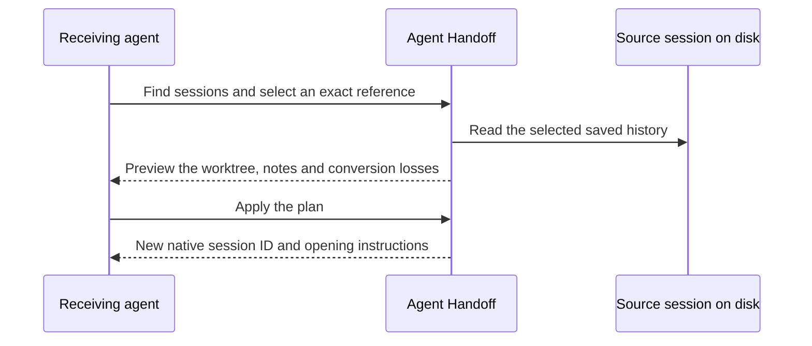

# Agent Handoff

[English](README.md) · [简体中文](README.zh-CN.md)

**Switch coding agents. Keep the conversation and the worktree.**

Codex hit its limit halfway through a fix? From Claude Desktop Code, pull the Codex session you were using. Open the new Claude session and pick up the failing test in the same Git worktree, with the conversation, tool results, and your project notes. Codex can be offline once its session is saved.

Agent Handoff is a local Rust CLI and [Model Context Protocol](https://modelcontextprotocol.io/) (MCP) server for macOS. Codex, Claude Desktop Code, and DeepSeek Harness can each be the source or the recipient. No cloud service or separate memory server is required.

## Your first handoff

You'll need Git, Rust 1.96 or later to build, and the clients you intend to use. For DeepSeek, see [Harness setup](#deepseek-harness). From a checkout of this repository:

```sh
cargo install --path . --locked
handoff --version
```

From the Git worktree where the **source session** was working:

```sh
handoff sessions --agent codex --project .
handoff preview SOURCE_ID --from codex --to claude-desktop
handoff apply PLAN_ID
```

1. Choose a session from the first command. Replace `SOURCE_ID` with its complete `id`, or its quoted `source_ref` if multiple sessions have the same ID.
2. Check the `workspace.cwd`, target, and reported losses in the preview. Use the preview's `id` for `PLAN_ID`.
3. Follow the returned `next_action`. In Claude Desktop's **Code** view, use `/resume` to find the new `Handoff …` session. Confirm its ID and working directory. Your staged edits and untracked files are already there.

`waiting_for_open` means the target session has been written. Repeating `apply` with the same plan ID reuses it. If the live source or bound notes change before the first apply, preview again.

## Pull from the receiving agent

Register the server with your client's local stdio MCP settings. For clients that use the JSON form:

```json
{
  "mcpServers": {
    "handoff": {
      "command": "handoff",
      "args": ["mcp"]
    }
  }
}
```

If a desktop client cannot find the executable, run `command -v handoff` and use its output as `command`. Give clients the same state directory to share plans and assignments. Then ask the receiving agent:

> Find my Codex sessions for this worktree. Show me the candidates before importing one. When I choose, prepare it for Claude Desktop Code and tell me how to open it.



| Client | Source name | Target name | Open the result |
|---|---|---|---|
| Codex | `codex` | `codex` | Follow the returned thread link. |
| Claude Desktop Code | `claude` | `claude-desktop` | Select the new session with `/resume` in Code. |
| DeepSeek Harness | `deepseek` | `deepseek` | Refresh your existing Harness page and select the session by ID. |

### DeepSeek Harness

The adapter uses the installed Harness SDK. The tested combination is `@deepseek-ai/dsh@0.2.2-rc.1`, Node.js 24.9+ and session format v4. Put `node` and `dsh` on the server's PATH, or pass `--dsh-package` with the Harness package directory if automatic discovery fails. Open the imported session in your existing Harness page; a new session may initially appear untitled. [DeepSeek Harness](https://github.com/deepseek-ai/deepseek-harness)

## Assign work for later

A sender can freeze a version and leave a task for a recipient. The recipient can claim it after the source session or original notes have gone offline. The original worktree must still be accessible.

```sh
# Sender: replace VERSION_ID with the id returned by capture.
handoff capture SOURCE_ID --from codex
handoff assign VERSION_ID --to deepseek --instructions "Fix the failing test and rerun it."

# Recipient: use the assignment id from the inbox.
handoff inbox --recipient deepseek
handoff claim ASSIGNMENT_ID --recipient deepseek
```

To reuse a saved version without an assignment, run `handoff prepare VERSION_ID --to TARGET` and then `handoff apply PLAN_ID`. For project conventions, bind a Markdown file **before** taking the snapshot, for example `handoff memory bind --project . --path ./NOTES.md`. Bound note contents become part of the target session.

## Connect your own agent

A local agent can join at runtime through the CLI or stdio MCP. Choose `source`, `target` or `both`. Agents using private storage can translate their records at this boundary.

```sh
handoff agents
handoff register-agent --id example-agent --role both --protocol-version 1
```

The result includes a private `sessions_dir`. Store one v1 JSON file per source session there. As a recipient, read the `target_path` returned by apply or claim, resume its messages in `workspace.cwd`, and save new turns under the same session ID. The hub takes a snapshot when a recipient pulls or someone requests a capture. The discovery response includes a minimal wire example. [Protocol and message examples](docs/agent-protocol.md)

## State maintenance

```sh
handoff memory list --project .
handoff memory unbind --project . --path /path/to/removed-note.md
handoff backup ../handoff-backup
handoff restore ../handoff-backup
handoff versions --limit 20
handoff inbox --recipient codex --limit 20
handoff archive TASK_ID
handoff gc --older-than 30d
handoff gc --older-than 30d --execute
```

Version and inbox pages return `next_cursor`. Pass it as `--cursor` on the next call (MCP `cursor`). Restore uses the original state directory recorded in the backup, validates a complete replacement tree, and retains the previous tree as `rollback_state`. Protocol sessions keep the longer valid continuation and reject divergent histories. Empty or damaged local sessions can recover from a valid backup. Healthy databases also get a `rollback_backup`. Preserve the original worktree and native client stores separately. GC previews explicitly archived tasks by default. Writer lock waits default to five seconds and can be adjusted with `--lock-timeout-seconds`. Restart MCP servers after upgrading to use the same locking protocol. [State lifecycle and recovery](docs/development-plan.md)

## CLI and MCP reference

| Task | CLI | MCP tool |
|---|---|---|
| Discover and register agents | `agents`, `register-agent` | `list_agents`, `register_agent` |
| Find a source | `sessions` | `find_sessions` |
| Preview, publish, inspect | `preview`, `apply`, `status` | `preview_handoff`, `apply_handoff`, `get_handoff` |
| Freeze and reuse a version | `capture`, `versions`, `prepare` | `capture_version`, `list_versions`, `prepare_handoff` |
| Assign and claim work | `assign`, `inbox`, `claim` | `assign_version`, `list_assignments`, `claim_assignment` |
| Read saved history or notes | `read` | `read_context` |
| Bind local Markdown | `memory bind` | CLI only |

Run `handoff COMMAND --help` for arguments. State defaults to `~/.local/share/agent-handoff`; override it with `--state-dir` or `HANDOFF_STATE_DIR`. Local state contains saved history, tool results and bound notes. Share the state directory only with clients you trust.

## Compatibility and verification

Handoff creates a **new native session** on the same machine. It uses the original worktree in place. Model state, credentials and approvals belong to the receiving client. Images and attachments have limited conversion support. Automatic acknowledgement from the GUI is outside the current scope.

All six cross-client directions have been exercised for both pull and assignment. The [validation guide](docs/m0-m6-recheck.md) distinguishes native storage tests from desktop checks and includes commands to reproduce the suite. See the [development plan](docs/development-plan.md) for adapter boundaries and planned work.

Built with [txcript](https://github.com/skillsynchq/txcript) and the DeepSeek Harness persistence SDK. Licensed under the [MIT License](LICENSE).
