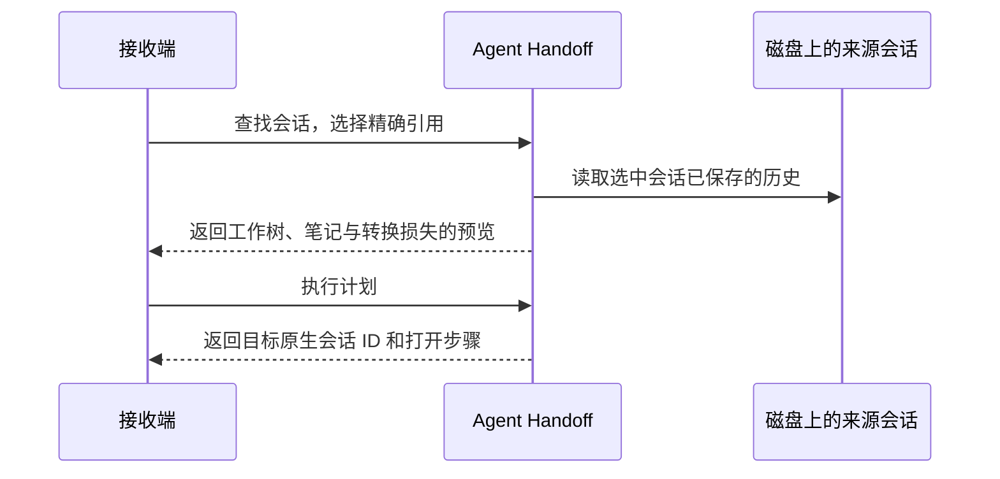

# Agent Handoff

[English](README.md) · [简体中文](README.zh-CN.md)

**换个编码助手，接着原来的会话，在同一个 worktree 里继续。**

Codex 修到一半用完了额度？在 Claude Desktop Code 里选中刚才的 Codex 会话，就能带着对话、工具结果和项目笔记，继续处理同一个失败用例。只要会话已经保存，Codex 可以离线。

Agent Handoff 是在 macOS 本地运行的 Rust CLI 和 [MCP](https://modelcontextprotocol.io/) 服务。Codex、Claude Desktop Code、DeepSeek Harness 都可以作为来源或接收端，直接使用本地会话记录，无需云端服务或额外的记忆服务。

## 第一次接手

准备 Git、Rust 1.96 或更新版本，以及需要交接的客户端。使用 DeepSeek 时还需配置 [Harness](#deepseek-harness)。在本仓库根目录安装：

```sh
cargo install --path . --locked
handoff --version
```

进入**来源会话原先工作的 Git worktree**，运行：

```sh
handoff sessions --agent codex --project .
handoff preview SOURCE_ID --from codex --to claude-desktop
handoff apply PLAN_ID
```

1. 从第一条命令的候选中选择会话，用完整的 `id` 替换 `SOURCE_ID`。如果 ID 重复，可使用带引号的精确 `source_ref`。
2. 在预览里核对 `workspace.cwd`、目标客户端和转换损失。用预览返回的 `id` 替换 `PLAN_ID`。
3. 按结果中的 `next_action` 打开。进入 Claude Desktop 的 **Code** 视图，用 `/resume` 寻找新建的 `Handoff …` 会话，核对目标 ID 和工作目录。暂存改动和未跟踪文件都在原处。

`waiting_for_open` 表示目标会话已经写入，等待客户端打开。使用同一计划 ID 重试会复用同一个目标。如果首次执行前来源历史或已绑定笔记有更新，请重新预览。

## 让接收端主动拉取

在接收端的本地 stdio MCP 配置中注册服务。使用 JSON 配置的客户端可填写：

```json
{
  "mcpServers": {
    "handoff": {
      "command": "handoff",
      "args": ["mcp"]
    }
  }
}
```

如果桌面客户端找不到命令，运行 `command -v handoff`，用输出替换 `command`。需要共享计划和指派的客户端应指向同一状态目录。然后可以在接收端直接说：

> 找出这个 worktree 的 Codex 会话，先列候选让我选。我选中后，把它准备成 Claude Desktop Code 会话，告诉我怎么打开。



| 客户端 | 来源名 | 目标名 | 打开方式 |
|---|---|---|---|
| Codex | `codex` | `codex` | 打开返回的会话链接。 |
| Claude Desktop Code | `claude` | `claude-desktop` | 在 Code 视图用 `/resume` 选择新会话。 |
| DeepSeek Harness | `deepseek` | `deepseek` | 刷新现有 Harness 页面，按目标 ID 打开。 |

### DeepSeek Harness

适配器读取本机安装的 Harness SDK。已验证的组合为 `@deepseek-ai/dsh@0.2.2-rc.1`、Node.js 24.9+ 和 v4 会话格式。MCP 服务的 PATH 应能找到 `node` 和 `dsh`；若无法自动定位 Harness 包，可用 `--dsh-package` 指定包目录。直接使用现有 Harness 页面即可，新会话首次打开前可能显示“未命名”。[DeepSeek Harness 项目](https://github.com/deepseek-ai/deepseek-harness)

## 把任务留给稍后上线的接收端

发送方可以保存一个独立版本，并写明接下来要做什么。接收方稍后领取时，来源会话和原笔记可以已经离线，原 worktree 仍须可访问。

```sh
# 发送方：用 capture 返回的 id 替换 VERSION_ID。
handoff capture SOURCE_ID --from codex
handoff assign VERSION_ID --to deepseek --instructions "修复最后一个失败用例并重新运行测试。"

# 接收方：用收件箱中的指派 ID 替换 ASSIGNMENT_ID。
handoff inbox --recipient deepseek
handoff claim ASSIGNMENT_ID --recipient deepseek
```

也可以直接用 `handoff prepare VERSION_ID --to TARGET` 从已保存的版本生成计划，再执行 `handoff apply PLAN_ID`。项目约定可以写入 Markdown，在创建快照**之前**运行 `handoff memory bind --project . --path ./NOTES.md`。绑定笔记的正文会进入目标会话。

## 让你的 agent 自主接入

在本机运行的 agent 可以通过 CLI 或 stdio MCP 注册，角色可选 `source`、`target` 或 `both`。注册立即生效，无需修改中转站源码。

```sh
handoff agents
handoff register-agent --id example-agent --role both --protocol-version 1
```

来源端在返回的 `sessions_dir` 中提供协议 JSON 文件，接收方拉取时才生成版本。接收端读取交付的 `target_path`，在 `workspace.cwd` 恢复消息并用同一会话 ID 保存续写。已有私有存储的客户端可以在自己一侧转换格式。[接入协议与消息样例](docs/agent-protocol.md)

## 本地状态维护

```sh
handoff memory list --project .
handoff memory unbind --project . --path /path/to/removed-note.md
handoff backup ../handoff-backup
handoff restore ../handoff-backup
handoff versions --limit 20
handoff inbox --recipient codex --limit 20
handoff archive TASK_ID
handoff gc --older-than 30d
handoff gc --older-than 30d --execute
```

版本和收件箱列表返回 `next_cursor`，下一页通过 `--cursor` 传入，MCP 使用 `cursor` 参数。恢复使用备份记录的原状态目录，校验完整暂存状态后切换，原目录保留为 `rollback_state`。协议会话采用较长的合法续写，历史分叉时报告冲突，空白或损坏的本地会话可用有效备份恢复。当前数据库健康时还生成 `rollback_backup`。原 worktree 和内置客户端会话库需要单独保留。清理默认预览显式归档的任务。写操作等待文件锁默认上限为 5 秒，可用 `--lock-timeout-seconds` 调整。升级后重启 MCP 服务以统一锁协议。[状态维护与恢复约定](docs/development-plan.md)

## CLI 与 MCP 接口

| 操作 | CLI | MCP 工具 |
|---|---|---|
| 发现与自主注册 | `agents`, `register-agent` | `list_agents`, `register_agent` |
| 查找来源会话 | `sessions` | `find_sessions` |
| 预览、发布、查状态 | `preview`、`apply`、`status` | `preview_handoff`、`apply_handoff`、`get_handoff` |
| 保存及复用独立版本 | `capture`、`versions`、`prepare` | `capture_version`、`list_versions`、`prepare_handoff` |
| 指派、查收及领取 | `assign`、`inbox`、`claim` | `assign_version`、`list_assignments`、`claim_assignment` |
| 回读历史或笔记 | `read` | `read_context` |
| 绑定本地 Markdown | `memory bind` | 仅 CLI |

运行 `handoff COMMAND --help` 查看参数。默认状态目录是 `~/.local/share/agent-handoff`，可通过 `--state-dir` 或 `HANDOFF_STATE_DIR` 指定。里面保存会话历史、工具结果和绑定的笔记，只与信任的本地客户端共享。

## 兼容范围与验证

中转站在同一台机器上创建**新的原生会话**，直接使用原 worktree。模型状态、凭据和审批由目标客户端管理；图片和附件的转换支持有限。当前版本由用户在目标客户端确认实际打开结果。

三端六个跨客户端方向都验证了主动拉取和离线指派。[验收与复现](docs/m0-m6-recheck.md) 说明原生存储与桌面验证的范围，并提供完整测试命令。[开发方案](docs/development-plan.md) 记录适配器边界和待扩展能力。

会话转换使用 [txcript](https://github.com/skillsynchq/txcript) 和 DeepSeek Harness 持久化 SDK。项目采用 [MIT 许可证](LICENSE)。
